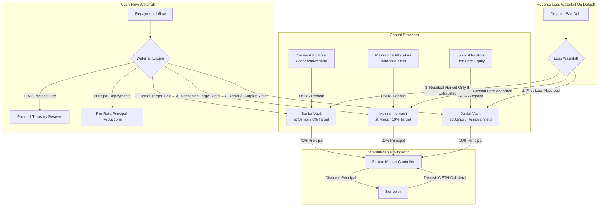

# StratumReserve

[](https://getfoundry.sh/)
[](https://soliditylang.org/)
[](https://opensource.org/licenses/MIT)
[-green.svg)](https://eips.ethereum.org/EIPS/eip-1153)

> **Production-Grade Multi-Tranche Structured Credit & Institutional Debt Securitization Protocol with Automated Waterfall Settlements, ERC-4626 Tokenized Tranche Vaults, Continuous Dual-Kink Interest Rate Engine, and Dutch Auction Soft Liquidations in Solidity.**

---

## 1. Executive Summary

**StratumReserve** is an institutional-grade structured credit and fixed-income securitization protocol implemented in Solidity for the EVM Cancun runtime. It enables overcollateralized borrowers to tap pooled multi-tranche liquidity while granting capital allocators customizable risk-return exposures through tokenized **ERC-4626** debt tranche vaults:

1. **Senior Tranche (AAA / First Priority)**:
   - Protected by subordinated equity/first-loss capital buffers.
   - Fixed target yield benchmark (e.g. 6.00% APR).
   - First-priority claim on all principal redemptions and cash flow interest distributions.
2. **Mezzanine Tranche (BBB / Second Priority)**:
   - Subordinated to Senior but senior to Junior.
   - Enhanced yield spread (e.g. 10.00% APR).
   - Second-loss absorption tier.
3. **Junior Tranche (First-Loss Equity / Residual Upside)**:
   - Takes 100% first-loss risk on loan defaults and liquidation haircuts.
   - In exchange, Junior captures **all residual surplus interest yield** above Senior and Mezzanine target rates, achieving leveraged yields (18.00% to 45.00%+ APR).

---

## 2. Protocol Architecture



---

## 3. Mathematical Foundations

### 3.1 Dual-Kink Piecewise Linear Interest Rate Model

The instantaneous borrow interest rate $R(U)$ is computed as a continuous function of pool-wide liquidity utilization $U$:

$$U = \frac{D_{\text{total}}}{C_{\text{pool}} + D_{\text{total}}}$$

where $D_{\text{total}}$ is total active borrowed debt, and $C_{\text{pool}}$ is aggregate liquid cash available across all vaults.

The annual borrow rate $R(U)$ follows:

$$R(U) = \begin{cases} 
R_0 + \left(\frac{U}{U_{\text{kink}}}\right) \cdot R_{\text{slope1}} & \text{if } U \le U_{\text{kink}} \\
R_0 + R_{\text{slope1}} + \left(\frac{U - U_{\text{kink}}}{1 - U_{\text{kink}}}\right) \cdot R_{\text{slope2}} & \text{if } U > U_{\text{kink}}
\end{cases}$$

**Default Parameters (in RAY $10^{27}$)**:
- Base Rate $R_0 = 0.02 \times 10^{27}$ (2.00% APR)
- Slope 1 $R_{\text{slope1}} = 0.08 \times 10^{27}$ (8.00% APR)
- Slope 2 $R_{\text{slope2}} = 0.50 \times 10^{27}$ (50.00% jump rate)
- Kink Utilization $U_{\text{kink}} = 0.80 \times 10^{27}$ (80.00%)

---

### 3.2 Continuous Compounding Factor

Interest factor over time interval $\Delta t$ is computed via second-order Taylor expansion to guarantee machine precision without iterative loops:

$$F(\Delta t) = 1 + \left(\frac{R \cdot \Delta t}{T_{\text{year}}}\right) + \frac{1}{2}\left(\frac{R \cdot \Delta t}{T_{\text{year}}}\right)^2$$

---

### 3.3 Cascading Priority Waterfall Distribution

Upon repayment of an interest installment $I_{\text{paid}}$:

1. **Protocol Treasury Fee**:
   $$\Phi_{\text{treasury}} = I_{\text{paid}} \times \beta_{\text{reserve}}$$
   $$I_{\text{net}} = I_{\text{paid}} - \Phi_{\text{treasury}}$$

2. **Senior Tranche Yield Distribution**:
   $$Y_{\text{senior}} = \min\left(I_{\text{net}}, \frac{P_{\text{senior}} \cdot r_{\text{senior}} \cdot \Delta t}{T_{\text{year}}}\right)$$
   $$I_{\text{rem1}} = I_{\text{net}} - Y_{\text{senior}}$$

3. **Mezzanine Tranche Yield Distribution**:
   $$Y_{\text{mezz}} = \min\left(I_{\text{rem1}}, \frac{P_{\text{mezz}} \cdot r_{\text{mezz}} \cdot \Delta t}{T_{\text{year}}}\right)$$
   $$I_{\text{rem2}} = I_{\text{rem1}} - Y_{\text{mezz}}$$

4. **Junior Tranche Residual Yield**:
   $$Y_{\text{junior}} = I_{\text{rem2}}$$

---

### 3.4 Dutch Auction Soft Liquidation Engine

When a loan's health factor drops below unity ($\text{HF} < 1.0$) or expires past its maturity timestamp $t_{\text{mat}}$, the collateral is auctioned via linear Dutch price decay:

$$P(t) = P_{\text{start}} - \left(\frac{t - t_0}{\Delta t_{\text{auction}}}\right) \cdot (P_{\text{start}} - P_{\text{floor}})$$

A liquidator purchasing collateral pays the outstanding loan debt in the underlying asset, settling the debt directly with `StratumMarket` and clearing tranches with zero external slippage.

---

## 4. Smart Contract Inventory

| Contract | Path | Role & Highlights | Runtime Size |
| :--- | :--- | :--- | :--- |
| `StratumMarket` | `src/market/StratumMarket.sol` | Central credit origination, LTV verification, interest accrual & waterfall settlement | 11,131 Bytes |
| `StratumTrancheVault` | `src/vaults/StratumTrancheVault.sol` | ERC-4626 Tokenized Tranche Vault with virtual shares & inflation defense | 5,665 Bytes |
| `StratumDutchAuction` | `src/liquidation/StratumDutchAuction.sol` | Continuous Dutch auction engine for distressed collateral liquidation | 3,609 Bytes |
| `StratumMath` | `src/libraries/StratumMath.sol` | Fixed-point Wad (18 dec) & Ray (27 dec) math, dual-kink model, Taylor compounding | Library (Inlined) |
| `TransientLock` | `src/libraries/TransientLock.sol` | EIP-1153 `TSTORE`/`TLOAD` reentrancy guard (Cancun EVM opcode assembly) | Library (Inlined) |
| `IStratumMarket` | `src/interfaces/IStratumMarket.sol` | Standard market interface & structs | Interface |
| `IStratumTrancheVault` | `src/interfaces/IStratumTrancheVault.sol` | Standard tranche vault interface | Interface |
| `IPriceOracle` | `src/interfaces/IPriceOracle.sol` | Price oracle interface | Interface |

---

## 5. Security Invariant & Fuzzing Suite

StratumReserve includes a comprehensive 37-test suite with 256 fuzz runs per property:

```
╭---------------------------------------------------------------------------------------------------------╮
| Suite                          | Tests Passed | Fuzz Runs | Status                                      |
+=========================================================================================================+
| StratumMathTest                | 13 / 13      | 256       | PASSED (Ray/Wad identity, kinks, Taylor)    |
| StratumTrancheVaultTest        | 10 / 10      | --        | PASSED (ERC-4626, inflation attack defense) |
| StratumMarketTest              | 8 / 8        | --        | PASSED (Origination, waterfall, defaults)   |
| StratumDutchAuctionTest        | 3 / 3        | --        | PASSED (Linear decay, auction clearance)    |
| StratumInvariantsTest          | 3 / 3        | 256       | PASSED (Tranche partition & waterfall cons) |
╰---------------------------------------------------------------------------------------------------------╯
Total: 37 / 37 PASSED (100% Clean)
```

### Verified Invariants:
1. **Tranche Partition Conservation**:
   $$\sum_{i \in \{\text{Senior, Mezz, Junior}\}} P_i \equiv B_{\text{borrowed}} \quad \forall B \in [10^2, 10^8] \text{ USDC}$$
2. **Waterfall Cash Flow Conservation**:
   $$\Phi_{\text{treasury}} + Y_{\text{senior}} + Y_{\text{mezz}} + Y_{\text{junior}} \equiv I_{\text{paid}} \quad (\text{zero wei leaked})$$
3. **Subordinated Tranche Protection**:
   $$\text{Loss}_{\text{senior}} \equiv 0 \quad \forall L \le P_{\text{junior}} + P_{\text{mezz}}$$

---

## 6. Build, Test & Deployment Guide

### Prerequisites
- [Foundry](https://getfoundry.sh/) (forge v1.8.7+)
- Linux / macOS / WSL Ubuntu

### Compilation
```bash
forge build --sizes
```

### Format Verification
```bash
forge fmt --check
```

### Run Test Suite
```bash
forge test -vvv --fuzz-runs 256
```

### Dry-Run Deployment Simulation
```bash
forge script script/DeployStratumReserve.s.sol
```

---

## 7. Design Trade-offs & Known Limitations

1. **Synchronous Tranche Ratios**:
   - Current release partitions capital stack using a fixed 70/20/10 Senior/Mezzanine/Junior ratio upon borrow origination. Future versions can introduce dynamic asset-liability matching (ALM) based on live tranche capacity.
2. **Oracle Dependency**:
   - Relies on external oracle price feeds (`IPriceOracle`). Production deployments should integrate Chainlink Data Feeds with heartbeat, deviation thresholds, and sequencer uptime feeds for Layer 2 rollups.

---

## 8. License

Distributed under the **MIT License**. See [LICENSE](LICENSE) for details.
